 

---

### 🧰 Tech stack

  

---

### 🔨 Waar ik aan werk

<!-- Pas aan naar wat je wil tonen. Link alleen naar publieke repos/sites. -->
| Project | Wat het is |
|---|---|
| **Summio** | AI-studie-app voor Belgische/Nederlandse studenten |
| **Shapevo** | Fitness & voeding app |
| **StudentDesk** | Admin-tool voor student-zelfstandigen |
| **SubTracker** | Abonnementen beheren |

---

### 🐍 Contributions

<picture>
  <source media="(prefers-color-scheme: dark)" srcset="https://raw.githubusercontent.com/YorreSaerens/YorreSaerens/output/github-snake-dark.svg" />
  <source media="(prefers-color-scheme: light)" srcset="https://raw.githubusercontent.com/YorreSaerens/YorreSaerens/output/github-snake.svg" />
  
</picture>

